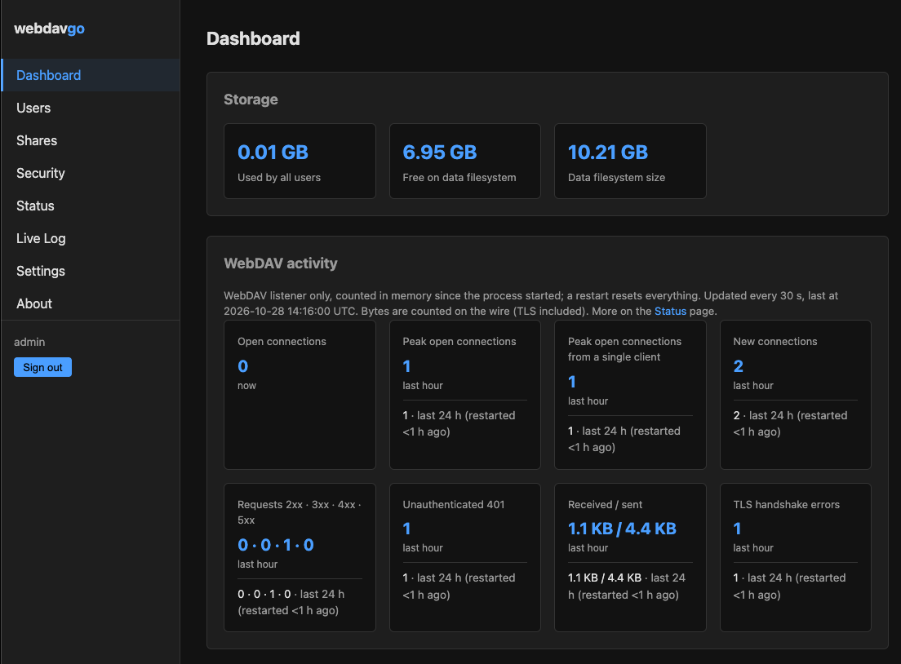
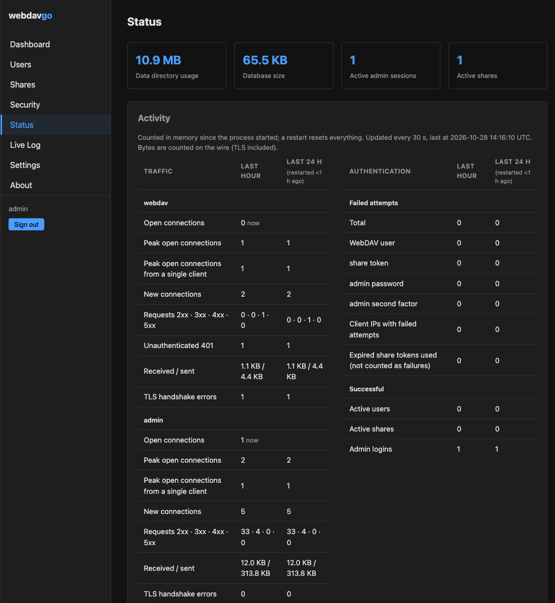

# webdavgo

webdavgo is a WebDAV file server in a single Go binary. It supports
WebDAV SEARCH (RFC 5323) and includes what is needed to run it directly
on the internet.

## Why

- **One function:** webdavgo serves files over WebDAV. It has no calendar,
  contacts, office, media or plugin features.
- **One binary:** Pure Go with embedded SQLite. No database server, no
  reverse proxy, no other runtime dependencies.
- **Easy to deploy:** Copy the binary to a Linux server, start it and
  finish the setup in the browser.
- **Internet-ready:** The server obtains and renews its TLS certificates
  from Let's Encrypt itself. Brute-force protection and request limits
  are built in.
- **SEARCH:** A client gets all files changed since a given time with a
  single request (`getlastmodified > T`) instead of walking the directory
  tree with PROPFIND. This also works inside shares.

To get a server running, see [Quick start](#quick-start).

## Screenshots




## Features

**WebDAV & sync**
- WebDAV SEARCH (RFC 5323) with the basicsearch grammar: `and`, `or`,
  `not`, comparisons, `like`, `contains`, `orderby` and `limit`
- Conditional requests (`If-Match`, `If-None-Match`), atomic PUT and
  consistent ETags
- Standard WebDAV without client-specific extensions

**Users & sharing**
- Multiple users, each with an isolated data directory and a storage quota
- Invite external recipients to a folder by email, without creating an
  account for them. Invites are created through a REST API
  (`/api/v1/shares`), the only part of webdavgo outside the WebDAV
  standard. Recipients then use plain WebDAV, including SEARCH

**Security features**
- Automatic TLS certificates via Let's Encrypt (ACME)
- Brute-force protection on all login paths
- Limits on slow request bodies
- Admin UI over HTTPS only, with TOTP two-factor authentication and
  CSRF protection

**Operation**
- First-run setup wizard with a one-time token
- `webdavgo install` sets the server up as a system service
- Web admin UI for users, shares, connections, activity and a live log
- Files are stored as plain files in the data directory and can be backed
  up with standard tools

## Quick start

You need:

- a Linux server with systemd (amd64 or arm64) and root access,
- a domain whose A record (and AAAA record for IPv6) points to the server,
- port 443 reachable from the internet. Behind a NAT router, forward TCP
  port 443 to the server. Let's Encrypt validates the domain on this port.

**1. Download and verify the latest release** (version and architecture
from the [Releases](https://github.com/joernfeuerabend/webdavgo/releases) page):

```sh
VERSION=0.1.0
ARCH=amd64
curl -LO https://github.com/joernfeuerabend/webdavgo/releases/download/v$VERSION/webdavgo_${VERSION}_linux_$ARCH.tar.gz
curl -LO https://github.com/joernfeuerabend/webdavgo/releases/download/v$VERSION/SHA256SUMS
sha256sum --ignore-missing -c SHA256SUMS
tar -xzf webdavgo_${VERSION}_linux_$ARCH.tar.gz
```

**2. Install it as a service:**

```sh
sudo ./webdavgo install
```

This copies the binary to `/usr/local/bin`, creates the `webdavgo` user,
`/etc/webdavgo` and `/var/lib/webdavgo`, and starts the systemd service.
At the end it prints a setup URL with a one-time token and the fingerprint
of the admin certificate.

**3. Create the admin account.** Open the setup URL in a browser. The
browser warns about a self-signed certificate: continue only if it shows
the printed fingerprint. Create the admin account, enroll an authenticator
app and store the recovery codes.

**4. Get the certificate.** Setup continues with **Domain & certificate**.
Enter your domain and select **Apply**. webdavgo checks DNS and port 443,
obtains a Let's Encrypt certificate and serves WebDAV at
`https://<your-domain>/`. No restart is needed.

**5. Add users** under **Admin → Users** and connect a WebDAV client to
`https://<your-domain>/`.

The admin UI listens on port 8443 on all interfaces, so on a server
without a firewall it is reachable from the internet. To keep it private,
block port 8443 in the firewall and open it through an SSH tunnel:
`ssh -N -L 8443:localhost:8443 user@your-server`, then use the
`https://localhost:8443/...` setup URL.

Setup token expired? `sudo webdavgo setup-info` prints a new one. To
update, download a newer release and run `sudo ./webdavgo install` again.
Data and configuration are kept.

To run webdavgo with Docker instead, see [Container](docs/installation.md#container).

## Documentation

- [Installation](docs/installation.md): first start, `webdavgo install`, domain and certificate, internet deployment
- [Configuration](docs/configuration.md): config file, all keys, Settings page, request limits
- [Administration](docs/administration.md): admin access and TOTP, Security, Status and Live Log pages, log files, brute-force protection, emergency recovery
- [Clients](docs/clients.md): SEARCH, ETags and conditional requests, hrefs, storage quota
- [Shares](docs/shares.md): email-bound shares and the share API
- [Development](docs/development.md): build and tests

## Not included

CalDAV/CardDAV, office integration, media galleries, plugin system.

- DNS-01 challenges, own certificates
- Environment variables for configuration
- Cross-user shares where the recipient is themselves a webdavgo user with
  their own filesystem (a recipient is identified solely by email and holds a
  share-specific token)
- Server-side email / invite delivery (the owner distributes the share URL and
  token through any channel)
- Anonymous / public shares (no email binding)
- Orphan-share cleanup (owner deletes the shared directory → recipient sees
  404, the share row remains until explicitly revoked)
- Persistent locks (lock state lives in memory, lost on restart)
- Share quota

## What comes next

- Signed release binaries and self-update
- Behind-proxy mode
- Invite-link flow for adding users

## License

Copyright (C) 2026 Jörn Feuerabend

This program is licensed under the GNU Affero General Public License,
version 3 only (AGPL-3.0-only). See [LICENSE](LICENSE).

A commercial license is available for use cases where the AGPL
obligations are not acceptable. Contact licensing@webdavgo.com.

Contributions require signing the Contributor License Agreement. See
[CONTRIBUTING.md](CONTRIBUTING.md).

Third-party components and their licenses are listed in
[THIRD_PARTY_LICENSES](THIRD_PARTY_LICENSES).
